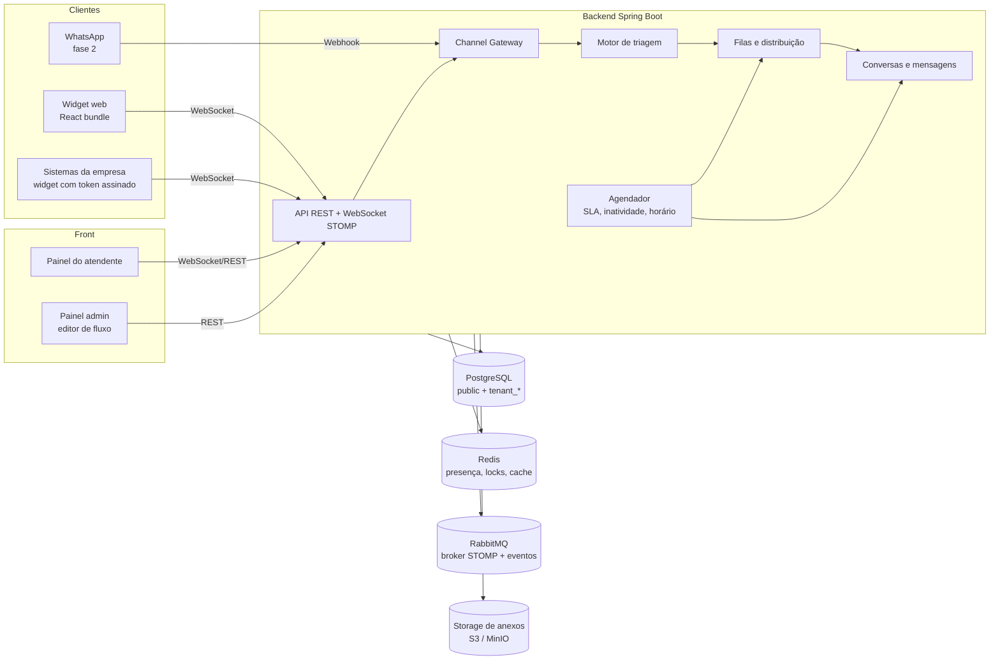
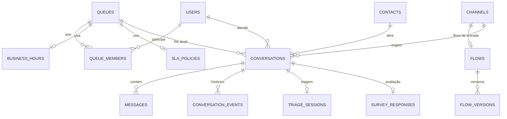

# Sistema de Chat de Suporte — Especificação de Arquitetura

> SaaS multiempresa de atendimento por chat, com funil de triagem configurável, filas e distribuição automática ou manual.
> Versão 0.1 · novembro de 2026

---

## 1. Visão geral

A plataforma permite que várias empresas (tenants) atendam os próprios clientes por chat. Cada empresa configura:

- **Canais de entrada**: widget web, integração com os próprios sistemas e WhatsApp (fase 2).
- **Fluxos de triagem**: perguntas e opções montadas num editor visual, que levam o cliente à fila certa.
- **Filas**: cada uma com seu modo de distribuição, horário de atendimento, SLA e equipe.
- **Atendentes e supervisores**: com capacidade de atendimentos simultâneos, pausas e transferências.

### Perfis de usuário

| Perfil | Onde atua | O que faz |
|---|---|---|
| Admin da plataforma | Painel da plataforma | Cria tenants, planos e acompanha o uso |
| Admin da empresa | Painel admin | Configura canais, fluxos, filas, horários, SLAs e usuários |
| Supervisor | Painel do atendente | Acompanha filas em tempo real, redistribui e transfere conversas |
| Atendente | Painel do atendente | Atende, transfere e encerra conversas |
| Cliente final | Widget / WhatsApp | Passa pela triagem e conversa com o atendente |

---

## 2. Decisões tomadas

| Tema | Decisão |
|---|---|
| Modelo de negócio | SaaS multiempresa |
| Backend | Java 21+ (LTS) com Spring Boot |
| Banco de dados | PostgreSQL |
| Multi-tenancy | **Um schema por empresa** (`tenant_<slug>`) + schema `public` para dados da plataforma |
| Front | React (Vite + TypeScript) |
| Canais | Widget web e integração com sistemas da empresa no MVP; WhatsApp Cloud API oficial na fase 2 |
| Triagem | Fluxo configurável pelo admin (editor visual) |
| Distribuição | Escolhida por fila: por setor, rodízio, menor carga ou o atendente puxa |
| Regras | Horário de atendimento, prioridade/SLA, transferência e posição na fila, encerramento e avaliação |
| Escala | Uma instância no início, arquitetura pronta para escalar horizontalmente |
| MVP | Widget web + triagem + filas + painel do atendente |

---

## 3. Arquitetura



### Componentes de infraestrutura

| Componente | Papel | Quando entra |
|---|---|---|
| PostgreSQL | Dados persistentes | MVP |
| Redis | Presença dos atendentes, locks de distribuição, cache de fluxos publicados, contadores de fila | MVP |
| RabbitMQ (plugin STOMP) | Broker relay do WebSocket entre várias instâncias e eventos internos | Opcional no MVP: começar com o simple broker do Spring e trocar pelo relay ao escalar |
| S3 / MinIO | Anexos (imagens, PDFs, áudios) | MVP ou fase 2 |

> **Por que RabbitMQ para o WebSocket:** o `StompBrokerRelay` do Spring fala STOMP direto com o RabbitMQ. Com duas ou mais instâncias do backend, uma mensagem publicada numa instância chega aos clientes conectados em qualquer outra. Isso funciona sem código extra.

---

## 4. Multi-tenancy: um schema por empresa

### 4.1 Organização do banco

```
public
 ├── tenants              (id, slug, schema_name, nome, plano, status, criado_em)
 ├── plans
 ├── platform_users       (admins da plataforma)
 ├── tenant_domains       (domínios/subdomínios → tenant)
 ├── channel_keys         (chave pública do widget → tenant)   ← lookup antes de saber o schema
 └── flyway_schema_history

tenant_acme
 ├── users, teams, queues, queue_members, ...
 └── flyway_schema_history

tenant_beltrao_tech
 └── ...
```

Regras:

- Nome do schema: `tenant_` + slug (`[a-z0-9_]`, até 50 caracteres), **validado por regex antes de qualquer SQL**. Nunca concatenar texto vindo do usuário em `SET search_path`.
- Tudo o que precisa ser consultado **antes** de saber o tenant (login, chave do widget, webhook do WhatsApp) fica em `public`.

### 4.2 Resolução do tenant em cada requisição

| Origem | Como identificar o tenant |
|---|---|
| Painel (atendente/admin) | Claim `tenant` no JWT; opcionalmente o subdomínio `acme.app.com` |
| Widget | `channel_key` pública enviada no handshake → lookup em `public.channel_keys` |
| Webhook WhatsApp (fase 2) | `phone_number_id` do payload → lookup em `public` |
| Jobs agendados | Iteram sobre `public.tenants` ativos e definem o tenant explicitamente |

O tenant resolvido vai para um `TenantContext` (ThreadLocal ou `ScopedValue`). Ele **precisa ser limpo no `finally`** de cada requisição, mensagem STOMP ou job.

### 4.3 Integração com Hibernate

No Hibernate 6, multi-tenancy por schema exige duas peças:

- **`CurrentTenantIdentifierResolver`**: lê o `TenantContext` e devolve o nome do schema. Fora de um tenant, devolve `public`.
- **`MultiTenantConnectionProvider`**: no `getConnection(tenant)`, pega uma conexão do pool e executa `SET search_path TO <schema>, public`; no `releaseConnection`, executa `SET search_path TO public` antes de devolver ao pool.

As duas são registradas via `HibernatePropertiesCustomizer` (`hibernate.multi_tenant_connection_provider` e `hibernate.tenant_identifier_resolver`).

Cuidados:

- **Resetar o `search_path` sempre.** Uma conexão devolvida ao pool com o schema errado é o maior risco desse modelo.
- Queries nativas e `JdbcTemplate` não passam pelo Hibernate. Use um `DataSource` decorado que aplica o mesmo `search_path`, ou só acesse o banco via JPA.
- Código assíncrono (`@Async`, `CompletableFuture`, listeners) não herda o ThreadLocal. Propague o tenant explicitamente, por exemplo com um `TaskDecorator`.

### 4.4 Migrações (Flyway)

```
src/main/resources/db/
 ├── public/   V1__tenants.sql, V2__plans.sql, ...
 └── tenant/   V1__base.sql, V2__queues_sla.sql, ...
```

- **Ao subir a aplicação:** migra `public`, depois percorre `public.tenants` e roda `Flyway.configure().schemas(schema).locations("classpath:db/tenant")` para cada um.
- **Onboarding de empresa:** `CREATE SCHEMA tenant_x` → Flyway com as migrações `tenant` → seed (fila padrão, fluxo padrão, admin) → `status = ATIVO`. Tudo numa operação idempotente: se falhar no meio, pode rodar de novo.
- **Falha em um tenant:** registra o erro, marca o tenant como `MIGRACAO_PENDENTE` e continua os demais. Tenants nesse estado recusam tráfego até serem corrigidos.
- **Migrações compatíveis com a versão anterior** (expand/contract): adicionar coluna nullable → código passa a usar → remover o antigo numa versão seguinte. Assim, versões diferentes de schema convivem durante o deploy.
- Com muitos tenants, a migração no startup fica lenta. Mova-a para um job/CLI separado no pipeline de deploy.

### 4.5 Limites e consequências conhecidas

| Ponto | Como tratar |
|---|---|
| Relatórios globais da plataforma | Tabela de métricas agregadas em `public`, alimentada por eventos; nada de `UNION` entre schemas em tempo real |
| Muitos schemas (milhares) | O catálogo do Postgres e o `pg_dump` ficam lentos. Planejar sharding por banco quando passar de algumas centenas de tenants |
| Backup/exclusão por cliente (LGPD) | `pg_dump -n tenant_x` e `DROP SCHEMA tenant_x CASCADE` |
| Cliente grande | Pode ir para um banco próprio: o `MultiTenantConnectionProvider` passa a escolher o `DataSource` além do schema |

---

## 5. Módulos do backend

Monólito modular. Cada módulo é um pacote com fronteira clara, comunicação por serviços e eventos de domínio. Isso permite extrair um serviço depois, se necessário (Spring Modulith ajuda a verificar as fronteiras).

| Módulo | Responsabilidade |
|---|---|
| `tenancy` | Tenants, onboarding, resolução de tenant, migrações |
| `identity` | Usuários, papéis, autenticação, JWT |
| `channel` | Gateway de entrada/saída: widget (WebSocket), sistemas da empresa (token assinado), WhatsApp (fase 2). Converte tudo para o formato interno de mensagem |
| `contact` | Cadastro do cliente final (nome, e-mail, telefone, documento, ID externo no sistema da empresa) |
| `triage` | Fluxos, versões, editor, motor de execução |
| `routing` | Filas, estratégias de distribuição, capacidade, posição na fila |
| `conversation` | Conversas, mensagens, transferências, encerramento |
| `agent` | Presença, status (online, pausa, offline), capacidade |
| `schedule` | Horários de atendimento e feriados por fila |
| `sla` | Políticas de SLA, cálculo de prazos e alertas |
| `feedback` | Pesquisa de satisfação (CSAT/NPS) e tabulação |
| `reporting` | Métricas: TME, TMA, abandono, SLA cumprido, CSAT |
| `attachment` | Upload e download de arquivos via URL assinada |

---

## 6. Modelo de dados (schema de cada tenant)



### Tabelas principais

**users**: `id, nome, email, senha_hash, papel (ADMIN|SUPERVISOR|AGENTE), capacidade_max, ativo`

**queues**: `id, nome, estrategia (SKILL|ROUND_ROBIN|LEAST_BUSY|MANUAL_PULL), business_hours_id, sla_policy_id, prioridade_padrao, capacidade_espera_max, mensagem_fora_horario, ativo`

**queue_members**: `queue_id, user_id, nivel (peso/proficiência), ultimo_recebimento_em` (o último campo serve ao rodízio)

**channels**: `id, tipo (WIDGET|EMBED|WHATSAPP), nome, channel_key, origens_permitidas[], segredo_assinatura, flow_id, config JSONB`

**flows / flow_versions**: `flow_versions(id, flow_id, numero, status (RASCUNHO|PUBLICADO|ARQUIVADO), definicao JSONB, publicado_em, publicado_por)`

**contacts**: `id, nome, email, telefone, documento, id_externo, atributos JSONB`

**conversations**:
`id, contact_id, channel_id, queue_id, agent_id, status, prioridade, entrou_fila_em, atribuida_em, primeira_resposta_em, encerrada_em, sla_primeira_resposta_ate, sla_resolucao_ate, motivo_encerramento, tabulacao_id, atributos JSONB`

`status` ∈ `TRIAGEM → NA_FILA → EM_ATENDIMENTO → AGUARDANDO_CLIENTE → ENCERRADA` (também `ABANDONADA` e `FORA_HORARIO`)

**messages**: `id, conversation_id, autor_tipo (CONTATO|AGENTE|SISTEMA|BOT), autor_id, tipo (TEXTO|IMAGEM|ARQUIVO|OPCOES|EVENTO), conteudo, anexo_url, id_externo, criado_em, entregue_em, lida_em`

**conversation_events**: trilha de auditoria (`ATRIBUIDA, TRANSFERIDA_FILA, TRANSFERIDA_AGENTE, PRIORIDADE_ALTERADA, SLA_ESTOURADO, ENCERRADA...`) com `de, para, usuario_id, motivo, criado_em`.

**triage_sessions**: `conversation_id, flow_version_id, node_atual, variaveis JSONB, iniciada_em, finalizada_em`

**business_hours**: `id, timezone, intervalos JSONB (dia da semana → faixas), feriados[]`

**sla_policies**: `id, nome, primeira_resposta_min, resolucao_min, por_prioridade JSONB, alerta_percentual`

**tabulations / survey_responses**: motivos de encerramento e notas CSAT/NPS com comentário.

### Índices essenciais

- `conversations (queue_id, status, prioridade DESC, entrou_fila_em)`: para montar a fila
- `conversations (agent_id, status)`: para a carga do atendente
- `messages (conversation_id, criado_em)`
- `contacts (id_externo)`, `contacts (telefone)`

A tabela `messages` deve ser particionada por mês quando o volume crescer.

---

## 7. Motor de triagem

### 7.1 Tipos de nó

| Nó | Função |
|---|---|
| `start` | Entrada do fluxo |
| `message` | Envia um texto ao cliente |
| `choice` | Pergunta com opções em botões; cada opção é uma saída |
| `input` | Pergunta aberta; grava a resposta numa variável (com validação: e-mail, CPF/CNPJ, número, regex) |
| `condition` | Desvia por regra (`variavel == valor`, `contato.atributo`, `canal`) |
| `business_hours` | Saída `aberto` / `fechado` conforme o horário da fila de destino |
| `set_attribute` | Grava atributo no contato ou na conversa |
| `set_priority` | Define a prioridade da conversa |
| `route_to_queue` | Encaminha para uma fila e encerra a triagem |
| `end` | Encerra a conversa (ex.: dúvida resolvida pelo autoatendimento) |

Fase 3: nó `ai_classify` (a IA lê a descrição e escolhe a saída) e `http_request` (consulta a API da empresa, ex.: status do cliente ou inadimplência).

### 7.2 Formato do fluxo (JSONB)

Formato compatível com o React Flow: `nodes` + `edges`. O editor salva direto, e o backend interpreta.

```json
{
  "nodes": [
    { "id": "n1", "type": "start" },
    { "id": "n2", "type": "message", "data": { "text": "Olá! Sou o assistente da {{empresa}}." } },
    { "id": "n3", "type": "input", "data": { "text": "Qual o seu CNPJ?", "variable": "cnpj", "validation": "cnpj" } },
    { "id": "n4", "type": "choice", "data": {
        "text": "Sobre o que você quer falar?",
        "options": [
          { "id": "o1", "label": "Financeiro" },
          { "id": "o2", "label": "Suporte técnico" },
          { "id": "o3", "label": "Fiscal / NF-e" }
        ]
    }},
    { "id": "n5", "type": "route_to_queue", "data": { "queueId": "q-financeiro" } },
    { "id": "n6", "type": "route_to_queue", "data": { "queueId": "q-suporte" } },
    { "id": "n7", "type": "route_to_queue", "data": { "queueId": "q-fiscal", "priority": "ALTA" } }
  ],
  "edges": [
    { "source": "n1", "target": "n2" },
    { "source": "n2", "target": "n3" },
    { "source": "n3", "target": "n4" },
    { "source": "n4", "sourceHandle": "o1", "target": "n5" },
    { "source": "n4", "sourceHandle": "o2", "target": "n6" },
    { "source": "n4", "sourceHandle": "o3", "target": "n7" }
  ]
}
```

### 7.3 Execução

1. A conversa nasce com `status = TRIAGEM` e cria uma `triage_session` apontando para a **versão publicada** do fluxo do canal.
2. O motor percorre os nós automáticos (`message`, `condition`, `set_*`) até chegar a um nó que espera o cliente (`choice`, `input`).
3. Cada resposta do cliente avança a sessão: grava a variável, escolhe a aresta e continua.
4. Ao chegar em `route_to_queue`, a conversa vai para `NA_FILA` e o módulo `routing` é acionado.
5. Opção inválida ou resposta fora do padrão: repete a pergunta até N vezes; depois, cai numa fila padrão.
6. Inatividade na triagem (ex.: 10 min) → conversa `ABANDONADA`.

### 7.4 Validação ao publicar

Tudo é verificado no backend antes de virar `PUBLICADO`:

- Exatamente um `start`.
- Todo nó é alcançável e todo caminho termina em `route_to_queue` ou `end`.
- Toda opção de `choice` tem aresta de saída.
- Filas referenciadas existem e estão ativas.
- Sem ciclos sem nó de espera (evita loop infinito).

Conversas em andamento continuam na versão em que começaram. Só conversas novas usam a nova versão.

---

## 8. Filas e distribuição

### 8.1 Estratégias (padrão Strategy)

```java
public interface DistributionStrategy {
    Optional<UUID> pickAgent(Queue queue, Conversation conversation, List<AgentState> elegiveis);
}
```

| Estratégia | Regra |
|---|---|
| `SKILL` | Elegíveis = membros da fila; escolhe pelo maior `nivel` e desempata por menor carga |
| `ROUND_ROBIN` | Entre os elegíveis, escolhe quem tem o `ultimo_recebimento_em` mais antigo |
| `LEAST_BUSY` | Escolhe quem tem a menor razão `atendimentos_ativos / capacidade_max` |
| `MANUAL_PULL` | Não atribui; a conversa aparece na lista da fila e o atendente clica em "Assumir" |

**Elegível** = membro da fila, status `ONLINE` (não em pausa), `atendimentos_ativos < capacidade_max`.

### 8.2 Quando o distribuidor roda

O distribuidor reage a eventos, não a polling:

- Conversa entrou na fila (fim da triagem ou transferência).
- Atendente ficou online, saiu da pausa ou encerrou um atendimento.
- Capacidade de um atendente foi alterada.
- A fila abriu (início do expediente).

Uma varredura periódica (ex.: a cada 30 s) serve de rede de segurança para eventos perdidos.

### 8.3 Concorrência

Duas instâncias (ou duas threads) não podem atribuir a mesma conversa nem estourar a capacidade de um atendente.

- **Seleção da conversa:** `SELECT ... FROM conversations WHERE queue_id = ? AND status = 'NA_FILA' ORDER BY prioridade DESC, entrou_fila_em LIMIT 1 FOR UPDATE SKIP LOCKED`
- **Reserva do atendente:** lock no Redis (`lock:agent:{tenant}:{id}`) ou `UPDATE` condicional (`... WHERE atendimentos_ativos < capacidade_max`) e verificação das linhas afetadas.
- **"Assumir" manual:** `UPDATE conversations SET agent_id = ?, status = 'EM_ATENDIMENTO' WHERE id = ? AND status = 'NA_FILA'`. Se 0 linhas forem afetadas, outro atendente já assumiu.

### 8.4 Presença dos atendentes

- O painel envia heartbeat pelo WebSocket. O Redis guarda `presence:{tenant}:{agentId}` com TTL de ~60 s.
- Ao desconectar sem heartbeat, o atendente vira `OFFLINE` após uma tolerância (ex.: 2 min). As conversas dele **não** voltam automaticamente para a fila; o supervisor decide, ou uma regra configurável faz isso.
- Pausas com motivo (almoço, reunião, treinamento) ficam registradas para relatório.

### 8.5 Posição na fila e tempo estimado

- **Posição** = quantidade de conversas na mesma fila com prioridade maior, ou com a mesma prioridade e entrada anterior.
- **Tempo estimado** = posição × TMA recente da fila ÷ atendentes elegíveis (média móvel da última hora).
- O cliente recebe a atualização quando a posição muda, com throttle (ex.: no máximo uma vez a cada 30 s).

---

## 9. Regras de atendimento

### 9.1 Horário de atendimento

- Cada fila aponta para um `business_hours` com timezone, faixas por dia da semana e feriados.
- Fora do horário, o nó `business_hours` da triagem desvia o fluxo, ou a fila responde `mensagem_fora_horario`. A conversa pode ser encerrada ou ficar em espera para o próximo expediente (configurável por fila).
- O relógio do SLA para fora do expediente (configurável).

### 9.2 Prioridade e SLA

- Prioridades: `BAIXA`, `NORMAL`, `ALTA`, `URGENTE`. Definidas pela triagem, por atributo do contato (ex.: cliente com contrato premium) ou manualmente pelo supervisor.
- A política de SLA define o tempo de **primeira resposta** e de **resolução** por prioridade.
- Ao entrar na fila, o backend calcula `sla_primeira_resposta_ate` (considerando o horário de atendimento).
- O agendador verifica prazos e dispara alertas ao supervisor em X% do prazo e ao estourar. Também registra `SLA_ESTOURADO` em `conversation_events`.

### 9.3 Transferência

- **Para outra fila:** a conversa volta para `NA_FILA` na fila de destino, mantendo a hora de entrada original (configurável) e a prioridade.
- **Para outro atendente:** direta, se ele tiver capacidade; caso contrário, entra na fila pessoal dele.
- Nota interna obrigatória (opcional por configuração), visível só para atendentes.
- O histórico completo acompanha a conversa.

### 9.4 Encerramento e avaliação

- **Encerramento manual** pelo atendente, com tabulação obrigatória (motivo) se configurado.
- **Encerramento por inatividade:** se o cliente não responder em X min, envia um aviso; após mais Y min, encerra.
- **Abandono:** cliente saiu da fila antes do atendimento (conta como abandono no relatório).
- **Pesquisa de satisfação:** enviada ao encerrar. CSAT de 1 a 5 e/ou NPS de 0 a 10, com comentário opcional.

---

## 10. Tempo real (WebSocket)

Spring WebSocket + STOMP.

| Destino | Quem assina | Conteúdo |
|---|---|---|
| `/topic/t.{tenant}.conv.{id}` | Cliente da conversa e atendente | Mensagens, digitando, lido |
| `/topic/t.{tenant}.queue.{queueId}` | Atendentes e supervisores da fila | Entrada/saída de conversas, tamanho da fila |
| `/user/queue/assignments` | Atendente | Nova conversa atribuída |
| `/topic/t.{tenant}.supervisor` | Supervisores | Alertas de SLA, status dos atendentes |

- **Autorização no `SUBSCRIBE`:** um `ChannelInterceptor` confere se o usuário pertence ao tenant e tem acesso ao destino. Sem isso, qualquer um assina qualquer tópico.
- O tenant vai no prefixo do destino e é conferido contra o token. Nunca confiar no que o cliente manda.
- Mensagens são gravadas no banco **antes** de serem publicadas. Na reconexão, o cliente pede as mensagens posteriores ao último `id` que recebeu.
- Escala: `enableSimpleBroker` com uma instância → `enableStompBrokerRelay` (RabbitMQ) com várias.

---

## 11. Widget e integração com os sistemas da empresa

### 11.1 Instalação

```html
<script src="https://cdn.suaplataforma.com/widget.js"
        data-channel-key="pk_live_abc123" async></script>
```

- O loader injeta um botão e abre o chat num **iframe**. Isso isola CSS/JS do site hospedeiro e mantém a sessão no domínio da plataforma.
- O backend valida o `Origin` contra `channels.origens_permitidas`.
- A sessão do cliente anônimo é um token próprio guardado no iframe. Se o cliente voltar, continua a conversa aberta.

### 11.2 Cliente identificado (sistemas da empresa)

Quando o widget é embutido num sistema da empresa (ERP, portal do cliente), o sistema já sabe quem é o usuário. O fluxo:

1. O backend do sistema da empresa gera um JWT assinado com o `segredo_assinatura` do canal (HS256), contendo `sub` (ID externo), `name`, `email`, `document` e atributos extras. Validade curta (ex.: 5 min).
2. O front do sistema passa o token ao widget: `SupportChat.identify(token)`.
3. A plataforma valida a assinatura, cria ou atualiza o `contact` por `id_externo` e pula as perguntas de triagem já respondidas (ex.: o CNPJ).

Isso evita que o cliente se passe por outro e permite usar atributos (plano, módulo do sistema) em nós `condition` da triagem.

---

## 12. Autenticação e autorização

- Spring Security com JWT (access token curto + refresh token).
- Claims: `sub`, `tenant`, `role`.
- Papéis: `PLATFORM_ADMIN`, `TENANT_ADMIN`, `SUPERVISOR`, `AGENT`.
- Login: o usuário informa o e-mail; o tenant vem do subdomínio ou de uma tela de escolha, se o e-mail existir em mais de um tenant.
- **Em aberto:** auth própria vs. Keycloak (SSO, 2FA e login social prontos, mas com mais um serviço para operar).

---

## 13. Front-end (React)

### 13.1 Aplicações

| App | Público | Destaques |
|---|---|---|
| `agent-console` | Atendentes e supervisores | Lista de conversas, chat, painel do contato, transferência, fila ao vivo, visão do supervisor |
| `admin` | Admin da empresa | Canais, filas, usuários, horários, SLA, tabulações, **editor de fluxo**, relatórios |
| `widget` | Cliente final | Bundle pequeno, carregado em iframe |

### 13.2 Stack sugerida

- Vite + React + TypeScript
- **React Flow (`@xyflow/react`)** para o editor de triagem
- TanStack Query para dados REST; Zustand para estado local
- Cliente STOMP: `@stomp/stompjs`
- UI: shadcn/ui + Tailwind no console e no admin. O widget usa CSS próprio e mínimo (bundle leve)
- Monorepo com pnpm workspaces: pacotes compartilhados de tipos, cliente da API e componentes de chat

---

## 14. Estrutura de repositórios

```
chat-suporte/
├── backend/                      # Spring Boot
│   └── src/main/java/.../
│       ├── tenancy/
│       ├── identity/
│       ├── channel/
│       ├── contact/
│       ├── triage/
│       ├── routing/
│       ├── conversation/
│       ├── agent/
│       ├── schedule/
│       ├── sla/
│       ├── feedback/
│       ├── reporting/
│       └── shared/               # erros, eventos, utilitários
├── frontend/
│   ├── apps/
│   │   ├── agent-console/
│   │   ├── admin/
│   │   └── widget/
│   └── packages/
│       ├── api-client/           # gerado do OpenAPI do backend
│       ├── chat-ui/
│       └── types/
├── infra/
│   └── docker-compose.yml        # postgres, redis, rabbitmq, minio
└── docs/
```

---

## 15. Roadmap

### Fase 1 — MVP

- [ ] Tenancy: onboarding, schemas, migrações por tenant
- [ ] Autenticação e papéis
- [ ] Canal widget (anônimo e identificado por token)
- [ ] Editor de fluxo com nós `start`, `message`, `choice`, `input`, `condition`, `business_hours`, `route_to_queue`, `end`
- [ ] Motor de triagem com versionamento
- [ ] Filas com as 4 estratégias de distribuição
- [ ] Presença, pausas e capacidade dos atendentes
- [ ] Painel do atendente: chat, transferência, encerramento com tabulação
- [ ] Horário de atendimento, prioridade e SLA com alertas
- [ ] Posição na fila e tempo estimado para o cliente
- [ ] CSAT ao encerrar
- [ ] Relatórios básicos: TME, TMA, abandono, SLA cumprido, CSAT

### Fase 2 — WhatsApp e operação

- [ ] Canal WhatsApp Cloud API: webhook, envio, mídia, status de entrega/leitura
- [ ] Janela de 24 h: fora dela, só templates aprovados (e pagos). O painel precisa avisar o atendente e oferecer os templates
- [ ] Embedded Signup da Meta, para cada empresa conectar o próprio número pelo painel
- [ ] Anexos em S3/MinIO
- [ ] Respostas rápidas (atalhos de mensagens prontas)
- [ ] RabbitMQ como broker relay e segunda instância do backend
- [ ] **Ligações:** servidor de mídia WebRTC com ponte SIP (ex.: LiveKit); chamadas pelo widget (voz, vídeo, compartilhamento de tela), telefone comum via provedor SIP e WhatsApp Calling API; URA usando o mesmo motor de triagem; ligações nas mesmas filas do chat; gravação e transcrição. Detalhes no `chat-suporte-frontend-plano.md`, seção 11

### Fase 3 — Inteligência e integrações

- [ ] Nó `ai_classify` na triagem
- [ ] Sugestão de resposta e resumo da conversa para o atendente
- [ ] Nó `http_request` para consultar APIs da empresa
- [ ] Webhooks de saída (conversa encerrada, SLA estourado) para integrar com ERPs
- [ ] Billing por plano (atendentes, conversas/mês)

---

## 16. Pontos em aberto

| # | Questão | Opções |
|---|---|---|
| 1 | Autenticação | Spring Security + JWT próprio / Keycloak |
| 2 | Anexos no MVP? | Sim (MinIO local) / Fase 2 |
| 3 | Conversas de atendente desconectado | Supervisor decide / volta para a fila após X min |
| 4 | Tempo na fila em transferência | Mantém hora de entrada original / reinicia |
| 5 | Retenção de mensagens | Para sempre / X meses por plano |
| 6 | Hospedagem | VPS + Docker Compose / Kubernetes / PaaS |
| 7 | Cobrança | Por atendente / por conversa / plano fixo |

---

## 17. Riscos e mitigação

| Risco | Mitigação |
|---|---|
| Conexão do pool com `search_path` errado vaza dados entre tenants | Reset obrigatório no `releaseConnection`, testes de integração que alternam tenants na mesma conexão, `TenantContext` limpo em `finally` |
| Migração falha em parte dos tenants | Migrações idempotentes e compatíveis com a versão anterior, status `MIGRACAO_PENDENTE`, job de migração separado do startup |
| Distribuição duplicada ou acima da capacidade | `FOR UPDATE SKIP LOCKED`, updates condicionais, locks no Redis |
| Mensagens perdidas na reconexão | Persistir antes de publicar e sincronizar por último `id` recebido |
| Assinatura de tópico de outro tenant | `ChannelInterceptor` validando tenant e permissão no `SUBSCRIBE` |
| Custo e restrições do WhatsApp | Avisar a janela de 24 h na UI, catálogo de templates por tenant, repassar o custo no plano |
| Crescimento de `messages` | Particionamento mensal e política de retenção |
